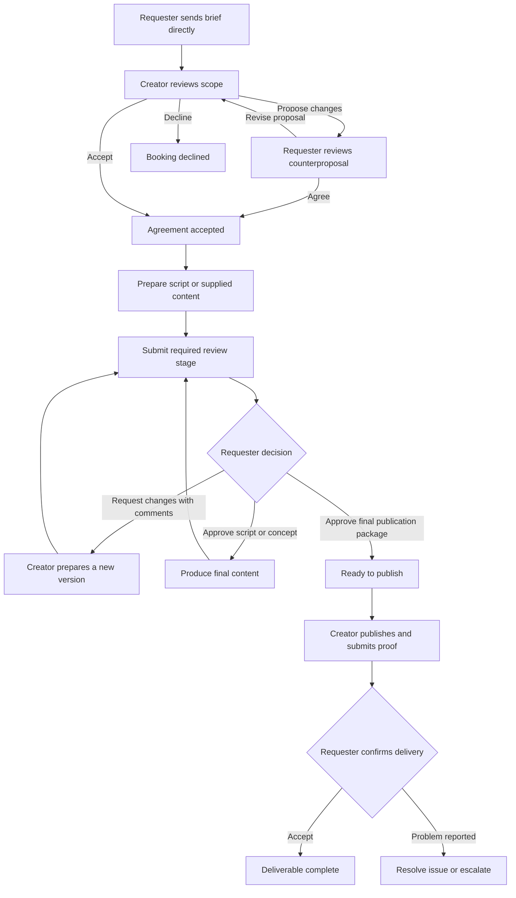

# Tikaddis content approval and delivery workflow

Planning document — October 28, 2026. Based on backend commit `216b681`.
This proposes the next implementation; the workflow below is not deployed yet.
Revised direction: direct requester–creator collaboration. Admin approval is not
part of sending a request, accepting work, reviewing content or confirming delivery.

## 1. Product direction

Give each promotion a shared workspace where the requester and creator agree on
the work, exchange drafts, approve specific versions, and confirm publication.

The feature is called a **content approval workflow**, or **creative review and
approval**. The text for a planned video is a **script**. A description of its
shots is a **storyboard** or **shot list**. A preview video is a **rough cut**.

The existing channel discovery and campaign brief remain the entry point. Channel
listing approval stays separate: a channel must be available for booking, but each
promotion request goes directly to its owner without another admin gate.

The shared workspace opens when the requester sends the brief, allowing both
participants to clarify the scope before acceptance. Production begins once they
agree. Approval is recorded inside Tikaddis; creators initially publish manually
through their social accounts. Requester and creator are roles in this booking,
not necessarily different global account types: an influencer can also commission
another creator.

### Participation and authority

| Action | Requester | Booked creator | Admin |
| --- | --- | --- | --- |
| Send brief and proposed scope | Yes | May request clarification | No approval step |
| Accept, decline or counterpropose a booking | Accept creator's counterproposal | Yes | No approval step |
| Change accepted scope | Propose; other participant must agree | Propose; other participant must agree | Cannot silently rewrite it |
| Submit creator drafts | Review submitted versions | Yes | No ordinary involvement |
| Approve creative or request changes | Yes | Respond with revisions | Cannot approve on requester's behalf |
| Publish and submit evidence | Review evidence | Yes | No ordinary involvement |
| Accept delivery | Yes | Supply evidence or resolve issues | Cannot record requester acceptance |
| Report or escalate an issue | Yes | Yes | Handles an opened case within its access scope |

Account authentication, validation and permissions are automatic platform checks,
not manual admin approval. Publishing curated formats/templates and approving
channel listings are platform-management tasks outside the booking pipeline.

### Example

A requester books one TikTok video and two stories:

1. They send the product, objective, reference examples, logo and key messages
   directly to the creator. The creator sees the request immediately.
2. The creator accepts the agreed deliverables, deadlines, price and revision terms.
3. The creator submits the video's script. The requester asks for a clearer offer.
4. The creator submits script version 2, which the requester approves.
5. The creator submits a private preview video and caption. The requester approves
   that exact version for publication.
6. The creator publishes it and submits the live post link.
7. The requester confirms delivery. Each story follows its own review and delivery
   steps; one approved video does not mark the whole campaign complete.

## 2. Three ways to commission content

| Mode | Requester supplies | Creator contributes | Default review |
| --- | --- | --- | --- |
| Publish supplied content | Final artwork/video/text, caption and instructions | Publishes the supplied material | Confirms the selected asset and caption; any adaptation needs review |
| Adapt a script or template | Script, outline, visual format or reusable template | Personalizes, records or designs the content | Approve the script when changed, then the final preview |
| Creator develops the content | Campaign brief, examples and constraints | Concept, script and final creative | Approve script/concept, then final preview |

Choose the mode per deliverable, not just per campaign. The same booking can
combine finished artwork for a story with an original video from the creator.

Do not force video production fields onto a simple Telegram text post. Select a
format first and reveal the relevant fields.

## 3. Structured deliverables

Replace the current free-text deliverables field as the only definition of scope
with a list of deliverable items. Keep the free-text brief for context.

Each item has:

- Name, platform/channel, format, content mode and description.
- Requested posting date/time, timezone, draft deadline and review deadline.
- Required review stages, mandatory messages, mentions, links and call to action.
- Expected duration, dimensions or number of slides when relevant.
- Selected template and a snapshot of its populated content.
- Agreed price or an explicit share of the campaign price; do not derive billing
  automatically from the number of dates or current channel prices.
- Agreed revision allowance and agreed usage terms, such as whether the requester
  may reuse the content in paid advertisements.

Represent three separately scheduled posts as three items. A carousel with five
slides is one item with five ordered assets, unless the parties agree otherwise.
Offer a shortcut to duplicate an item across dates without hiding this distinction.

The existing request targets one creator channel. Keep that boundary initially.
Later, an optional parent Campaign can group bookings across channels or creators;
each booking retains its own scope, access permissions and approval process.

### Starter formats

| Format | Useful structured fields |
| --- | --- |
| Text post | Body, links, mentions, hashtags, optional image |
| Short video / reel | Hook, script, shot list, duration, on-screen text, caption, cover |
| Story | Ordered frames, per-frame text/assets, link instructions, expiry considerations |
| Carousel | Ordered slides, per-slide copy/assets, caption and call to action |
| Long video / sponsor segment | Outline, talking points, segment duration, placement and description links |
| Custom | Description, required files and explicit acceptance criteria |

Admin-managed format definitions have stable codes and versioned field schemas.
Maintaining this catalog does not require approval of individual bookings or
their chosen format. Existing items keep their schema snapshot when admins change
a format. A format does not imply automatic platform publishing.

## 4. Templates and requester-supplied material

A **format** describes the kind of content. A **template** supplies reusable
content and structure for that format.

Provide three starting points: Start from a brief, Use a template, or Upload ready
content. A template can include a script outline, storyboard, caption, example
assets and placeholders such as product, offer, contact, location and campaign link.

- Requesters can save private templates and reusable brand assets.
- Admins can publish curated starter templates; creators can have private reusable
  outlines without exposing another customer's material.
- Add requirements such as “include this exact offer” and “do not make these claims.”
  Clearly distinguish mandatory copy from suggestions creators can personalize.
- Resolve required placeholders before sending a request. Copy the populated
  template into the deliverable; later template edits cannot alter accepted work.
- Record whether creator adaptation is permitted. Supplied final content still
  needs an agreed publishing schedule and a clear record of which asset was chosen.
- New or materially changed requester content after acceptance is a scope-change
  proposal, not a silent overwrite of the creator's accepted assignment.

## 5. Agreement before production

The current proposed budget is not an agreed price. Before starting, record a
versioned agreement covering deliverables, content modes, total ETB price, draft
and posting dates, review stages, revision allowance and usage terms.

The creator can Accept, Decline, or Propose changes. A counterproposal becomes
effective only when the other participant accepts it. An agreement is a snapshot;
accepted scope cannot change through an ordinary edit endpoint.

Start with a simple agreement confirmation flow. Full contract drafting, payment
processing and automated payouts are separate projects.

## 6. Workflow and approval rules

### Booking lifecycle

`Draft → Sent to creator → Agreement / counterproposal → Active → Completed`

Sending is a requester action. Acceptance is a creator action against the latest
scope; a counterproposal needs the requester's acceptance. The requester's send
action records agreement to their own proposed version, so unchanged creator
acceptance can activate the booking without an unnecessary second confirmation.
Every revised proposal identifies its proposer and the other required accepter.

Suggested stored booking states are `DRAFT`, `SENT`, `NEGOTIATING`, `ACTIVE`,
`COMPLETED`, `DECLINED` and `CANCELLED`. Awaiting a particular person's agreement
is derived from the current proposal and its decisions. Admin approval is absent
from these states and from the participant action rules.

Before acceptance, the requester can withdraw and the creator can decline. After
acceptance, scope changes and ordinary cancellation require both participants'
agreement; an unresolved issue can be escalated. A dispute is a separate case
linked to the booking, with an explicit hold only where necessary. A support
ticket does not automatically stop unrelated deliverables or rewrite their states.

The booking becomes active from the parties' agreement. Production begins through
creator work and submissions. Completion is derived from accepted delivery of all
required items. Admins do not manually mark ordinary work running or fulfilled.

### Deliverable lifecycle

The stage configuration determines which branch applies. A text post may need
only final-text approval; a video normally needs script and final-video approval.
Do not send an approved final stage back through video production.

Rules the server must enforce:

1. A sent request is immediately visible to its booked creator. Only the requesting
   account can give normal creative approval. Only the booked channel owner can
   submit its creator drafts. Admins cannot use these commands on their behalf;
   case decisions are distinct records and never count as participant approval.
2. Drafts in progress are private to their author. Submission creates a reviewable,
   immutable version. Participants cannot edit a submitted version in place.
3. Every approval identifies the deliverable, review stage, version, reviewer,
   timestamp and agreed scope version.
4. Script approval authorizes production. It does not approve an unseen video,
   changed caption, cover or final publication package.
5. Final approval covers the exact video/image/text, caption, cover, links and
   required disclosure supplied for publication. Changed material needs a new review.
6. A replacement script invalidates dependent later approvals. Preserve the old
   approval in history; it is no longer the effective publishing authorization.
7. Comments and “Request changes” are different operations. Comments do not change
   status by themselves. A formal revision request requires a clear summary.
8. Only one version per review stage is current. Late actions against a replaced
   version return a conflict and show the current version.
9. No response is not approval. Overdue reviews trigger reminders and a schedule
   adjustment/escalation option; they never silently authorize publication.
10. Publishing remains an external creator action. Tikaddis can block its own
    Ready-to-publish state; it cannot prevent a person posting outside the app.

Use independent fields for production state, review state and delivery state,
instead of multiplying every combination into one campaign status enum. The
campaign summary is derived from its deliverables and unresolved issues.

## 7. Feedback and revisions

Give each submitted version a review thread. Support ordinary comments, replies
and a consolidated revision request. Start with text feedback and optional video
time references such as “00:12”; add visual pin annotations later.

On mobile, put **Approve this version** and **Request changes** below the preview,
with the exact stage and version visible. Confirm final approval explicitly.
Let the requester collect comments before sending one revision request, so the
creator does not receive a conflicting instruction after every individual comment.

Show remaining agreed revision rounds. Count a round when the requester sends a
formal change request and the creator responds with a replacement submission;
individual comments are not separate paid revision rounds. Further rounds first
need agreement between the participants. Either person may escalate an unresolved
disagreement; routine revisions never require an admin decision.

Distinguish fixing a failure to meet the accepted brief from adding new scope.
For example, correcting a missing agreed product mention is different from asking
for an additional video. Record any scope, price or deadline amendment explicitly.

## 8. Publication and completion

After final approval, the creator publishes externally and submits the live post
URL, actual posting time and optional screenshot evidence. Ephemeral stories need
evidence that can still be reviewed after expiry.

The requester checks that the content and placement match the agreement, then
accepts delivery or reports an issue. Pre-publication approval and post-publication
delivery acceptance are separate records.

Complete a booking only when every required item has accepted delivery and there
is no blocking dispute. Progress should say “2 of 3 deliverables accepted,” with
the remaining task and responsible person visible. One completed item cannot mark
the entire booking fulfilled.

Submitted post links and screenshots are evidence, not automatically verified
platform results. Show submitted metrics separately from future verified metrics.
Payment release, if later introduced, must follow a separate payment policy and
ledger; a content status update alone must not move money.

## 9. Mobile experience

Both participants open the same **Campaign workspace**, with actions determined
by their participation and the current item state.

- **Overview:** agreed scope, dates, price, progress, next action and overdue tasks.
- **Deliverables:** one card per item, such as “TikTok video — Script awaiting your
  review” or “Telegram post — Ready to publish.”
- **Review:** draft preview, caption/script, version selector, feedback thread and
  permitted review actions. Submitted versions remain available for comparison.
- **Files:** requester assets, templates, submitted creative and publication proof,
  grouped by purpose so they are not confused with each other.
- **Activity:** real timeline of acceptance, submission, requested changes,
  approvals, amendments and delivery, with actor and timestamp.

Requester home emphasizes Awaiting my review. Creator home emphasizes Draft due,
Changes requested and Ready to publish. Show the next action before a generic
status label. Reuse the current theme, platform icon accents and AppToast.

The creator's inbox shows sent requests immediately, with Accept, Decline and
Propose changes. Replace “Waiting for admin approval” in the new-workflow UI with
the actual next participant action. Notify the creator when a request is sent.

Admin gets a separate reports/support/disputes queue. No routine approval inbox
or general private-draft review is part of this workspace. Participants can use
Report or Get help without leaving the booking, choosing the item and evidence
relevant to their case.

### Reports, disputes and exceptional intervention

Normal feedback, counterproposals and schedule changes stay between participants.
Either participant can open a case for non-delivery, non-response, disagreement or
reported abuse. Platform safety reports can also create a case independently.

Each case records the reason, relevant booking/items, submitted evidence, assigned
staff, any necessary hold, access grants, actions and resolution. Staff access is
limited to the case's relevant records and is audited; an admin role alone does
not grant unrestricted draft/media access in the new architecture.

A platform restriction, case closure or administrative resolution is labeled as
such. It cannot manufacture a requester approval, creator agreement or delivery
acceptance. If exceptional closure is necessary, preserve that outcome separately
from normal completion. Releasing a hold restores the prior workflow; it does not
auto-approve content. Overdue work can prompt reminders and an offer to escalate;
it does not automatically hand ordinary decision-making to an admin.

## 10. Backend architecture

Extend the current Spring Boot application as a modular monolith. A separate
microservice system is unnecessary for the first version.

| Record | Responsibility |
| --- | --- |
| Existing PromotionRequest | Booking identity, requester, creator channel and legacy compatibility |
| BookingWorkflow | Workflow version, direct participant lifecycle and current agreement reference |
| AgreementVersion | Accepted scope, total price, revisions, usage terms, deadlines and both decisions |
| Deliverable | One publishable item, format snapshot, mode, schedule and current states |
| ReviewStage | Required script/concept/final-package stages and their dependencies |
| DraftVersion | Immutable submitted content and publication package; links to stage and scope version |
| ReviewDecision | Approve or request changes against a specific submitted version |
| Comment | Thread/replies tied to a particular version, with author and timestamp |
| TemplateVersion | Owner/visibility, format, placeholders and reusable content snapshot |
| MediaAsset | Private file metadata, storage key, purpose, uploader, processing state and ownership |
| PublicationSubmission | Live URL, actual posting time and evidence for one deliverable |
| DeliveryDecision | Requester's acceptance or issue report for one publication submission |
| CampaignEvent | Append-only activity history with actor, action, entity/version and timestamp |
| Notification + OutboxEvent | Real notifications and reliable asynchronous delivery |
| SupportCase + CaseAccessGrant | Scoped exceptional assistance, reports, disputes and audited staff access |

Use relational references for ownership and decisions. Use bounded, validated
structured JSON for format-specific creative fields; avoid making a free-text
status or a single feedback string the source of workflow truth.

Validate transitions centrally in application services, inside transactions. Use
optimistic locking and expected-version checks to prevent simultaneous approval,
replacement and cancellation from overwriting one another. Add idempotency keys
to submissions and review decisions so mobile retries do not duplicate work.

Save events and notification outbox entries in the same transaction as each
decision. A background worker delivers notifications with retry and deduplication.
Start with real in-app notifications, then push notifications. Replace the
existing demonstration notification list with server-backed records.

### Proposed API shape

All routes require authentication and participant/ownership checks on the server.
Public IDs identify resources; client-supplied user IDs never grant access. A
booking's participant identities determine its actions, not a broad USER versus
INFLUENCER distinction. Admin status does not bypass participant checks.

| Action | Example route |
| --- | --- |
| Read workspace | `GET /campaign-requests/{id}/workspace` |
| Send brief directly to creator | `POST /campaign-requests/{id}/send` |
| Decline / withdraw before agreement | `POST /campaign-requests/{id}/decline`, `POST /campaign-requests/{id}/withdraw` |
| Propose / accept agreement | `POST /campaign-requests/{id}/agreements`, `POST /agreements/{id}/accept` |
| Manage items before agreement | `POST /campaign-requests/{id}/deliverables` |
| Save private working draft | `PUT /deliverables/{id}/working-draft` |
| Submit immutable version | `POST /deliverables/{id}/submissions` |
| Read submission / versions | `GET /deliverables/{id}/submissions` |
| Comment | `POST /submissions/{id}/comments` |
| Approve / request changes | `POST /submissions/{id}/review-decisions` |
| Propose scope amendment | `POST /campaign-requests/{id}/amendments` |
| Submit publication proof | `POST /deliverables/{id}/publications` |
| Accept delivery / report issue | `POST /publications/{id}/delivery-decisions` |
| Read real activity | `GET /campaign-requests/{id}/events` |
| Manage templates | `/content-templates` |
| Request upload / finalize upload | `POST /media/uploads`, `POST /media/uploads/{id}/complete` |
| Open a participant support/dispute case | `POST /campaign-requests/{id}/cases` |
| Staff case actions under scoped access | `POST /admin/cases/{id}/actions` |

Do not expose a generic `setStatus` endpoint. Each command has a named business
purpose, allowed actor, expected current version and explicit transition rules.

## 11. Media architecture

Current attachments support JPG/PNG/PDF up to 5 MB and store bytes in the database.
That is not a complete video draft pipeline. Do not simply increase its limit
and start storing large videos in the same tables.

For video, introduce private object storage with authenticated upload initiation,
short-lived scoped upload authorization, upload completion validation, file-size
and content-type checks, processing status, preview generation and resumable uploads
where supported. Use a configurable product limit validated on both sides.

Store metadata and authorization relationships in the database. An upload is not
reviewable until processing succeeds. Authorize every preview/download request
before issuing short-lived read access; permanent public draft URLs are unsuitable.
Clean up abandoned uploads. Preserve assets referenced by accepted versions and
apply an explicit retention policy instead of accidental cascade deletion.

Normal media access belongs to the asset author and the booking participant with
whom the asset has been shared. Submitted versions are shared with the other
participant; private working drafts and private template libraries are not. Staff
access requires a relevant case grant and a recorded reason. Existing legacy
attachment routes must not provide a broad-admin back door to new-workflow assets.

The first video release can accept private final-preview uploads and plain text
scripts. Advanced video editing, annotations and platform publishing are later
features. Existing request attachments should continue working during migration.

## 12. Migration and rollout

1. Add new tables and nullable references. Preserve existing requests and files.
2. Add a `workflowVersion` marker. Preserve existing history and make the version
   explicit; all newly sent requests use direct creator routing once rollout is
   enabled. `SENT` immediately appears in the creator's inbox, with its shared
   brief/assets readable before acceptance. No `ADMIN_APPROVED` prerequisite
   applies to new-workflow lists, decisions, media access or notifications.
3. The existing `PromotionRequestStatus` is stored using JPA's ordinal default.
   Do not reorder its enum or insert new values in the middle. Store new workflow
   states as explicit strings in new columns/tables. Any conversion of legacy
   statuses needs a deliberate data migration with backups and validation.
4. For new-workflow requests, reject legacy admin approve/reject, manual
   RUNNING/FULFILLED transitions, and generic edits that could bypass the agreement,
   draft-review or delivery rules. Legacy enum fields must never become the source
   of truth for these bookings. Admin case commands record restrictions/resolutions
   separately; they cannot create a participant approval or ordinary completion.
5. Add workflow/version capability information so older apps can read a safe
   summary but cannot bypass the new gates. Deploy backend support first, then
   the mobile workspace, then enable new-workflow creation.
6. Offer an explicit migration/confirmation flow for existing active bookings;
   do not invent approved drafts, agreed prices or historical timestamps. For
   existing requests waiting on admin review, offer the requester a Send directly
   action into the new workflow, then notify the creator. Preserve the old status
   in history instead of pretending admin approval happened. Historical rejected,
   cancelled and completed requests are not silently re-opened or re-sent.
7. Keep the existing production schema guard and CI tests. Use explicit additive
   migrations for these workflow tables rather than relying on automatic schema
   changes for the full rollout.

## 13. Implementation sequence

### Phase 1 — Usable approval and delivery workflow

Build a complete first path: direct request sending and creator inbox, participant
agreement, structured deliverables, immutable accepted scope, script/final-content
review stages, version history, comments, request changes, final approval,
publication proof, requester delivery acceptance, real timeline and in-app
notifications. Include private media support for the formats enabled at launch;
enabling video requires the video storage and preview work above. Include a basic
Report/Get help flow with scoped staff access; no ordinary stage waits on staff.

This phase must complete the journey from directly sent brief to accepted delivery.
It should not stop after adding draft statuses without a usable review screen.

### Phase 2 — Reuse and collaboration

Add private brand libraries, reusable templates, curated starter templates,
counterproposals and richer scope amendments, push reminders, comparison tools,
story/carousel previews and optional timestamp annotations. Start Phase 1 with
simple mutually confirmed terms; do not defer the existence of accepted scope.

### Phase 3 — Measurement and financial operations

Add campaign-level result submissions, independently sourced metrics where feasible,
payments and payout reconciliation as separate integrations. Add multi-creator
campaign grouping after per-booking delivery is reliable. Automatic publishing
is optional and must not be assumed by the approval workflow.

## 14. Acceptance criteria

- A requester can commission a creator from a brief, supplied template or final asset.
- A sent booking appears immediately in the booked creator's inbox without admin approval.
- The creator can read the shared brief/assets and accept, decline or propose changes.
- Both parties' agreement activates the booking without an admin running-status action.
- A booking can have several independently reviewed and scheduled items.
- A creator cannot start against an unaccepted or silently changed scope.
- A requester can comment, request changes and approve an exact submitted version.
- Script approval alone cannot satisfy a required final-video approval stage.
- New material cannot inherit an obsolete approval.
- An unrelated account cannot read drafts, comments or media, or give decisions.
- Only current approved publication packages reach Ready to publish.
- Each posted item has separate evidence and requester delivery confirmation.
- Completion reflects all required items and any blocking disputes.
- Requester delivery decisions determine normal completion; no admin fulfillment action is needed.
- Admin endpoints cannot approve creative, accept agreements or confirm delivery for a participant.
- Staff can access private booking evidence only through an applicable audited case grant.
- Channel-listing approval and format/template catalog management remain separate from booking approval.
- Every consequential action is recorded with its actor, time and relevant version.
- Duplicate requests and simultaneous edits cannot create conflicting approvals.
- Notifications come from persisted events, including retry after delivery failures.
- Existing campaigns remain readable and legacy routes cannot bypass new workflows.
- Old client filters cannot hide new sent requests or require an admin-approved enum value.

## 15. Product measures

Track creator acceptance rate, time to first draft, requester review response time,
revision rounds, on-time publication, delivery acceptance, disputes and repeat
bookings. These measure workflow usefulness; they are separate from advertising
performance metrics such as post reach or conversion.

The product promise is clear: the requester knows what was approved and delivered;
the creator knows the scope, compensation proposal, deadlines and remaining work.
Templates reduce repeated work while versioned approvals make collaboration
traceable and protect both participants from misunderstandings.
